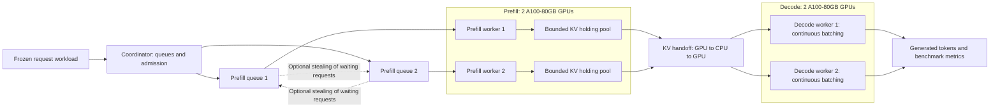

# DistEngine

DistEngine is a distributed inference engine for TinyLlama, inspired by [DistServe](https://www.usenix.org/conference/osdi24/presentation/zhong-yinmin). It runs prefill and decode independently across GPU workers, with paged KV storage, continuous decode batching, and optional work stealing to balance prefill queues. Ray coordinates the workers, and Modal runs the GPU benchmark.


## Architecture



Each GPU holds a complete TinyLlama model and its own paged KV cache. Ray actors
let prefill and decode progress independently. The coordinator admits KV transfers
when a decode worker has capacity; source KV is released after import succeeds.
Each request stays with its assigned decode worker. Full holding pools pause
prefill admission, while optional stealing moves only unstarted requests.


### 1. Install and authenticate

```bash
uv sync --locked
uv tool install modal
modal setup
```

### 2. Generate the benchmark workload

```bash
PYTHONPATH=src uv run python src/utils/freeze_workload.py \
  --output workloads/baseline \
  --num-requests 200 --rate-rps 5 --max-new-tokens 16 \
  --kv-capacity-tokens 2048 --num-prefill-workers 2
```


### 3. Run the benchmark

```bash
modal run src/Modal/run_benchmark.py --output results/baseline-run
```

To compare work stealing on and off using the same four GPUs:

```bash
modal run src/Modal/run_benchmark.py \
  --compare-stealing --output results/stealing-comparison
```

## View results

Results are saved **on your computer** in the output directory:

- `results/baseline-run/baseline.json`: full report with throughput, latency,
  goodput, worker activity, and sampled GPU utilization.
- `results/baseline-run/run-00.json` (and subsequent run files): individual passes.
- For the paired comparison, open
  `results/stealing-comparison/baseline.json` and inspect `comparison.no-stealing`
  and `comparison.stealing`.


## Benchmark results

TinyLlama-1.1B, two prefill + two decode A100-80GB GPUs; 200 Poisson requests at 5 requests/second, 16 output tokens, decode batch four, and three passes per policy.


### Baseline: no work stealing

| Metric | Result |
| --- | ---: |
| Request throughput | 4.795 requests/s |
| Output throughput | 76.716 tokens/s |
| Median time to first token | 0.165 s |
| P95 time to first token | 0.609 s |
| Median time per output token | 0.253 s |
| P95 time per output token | 0.353 s |
| Median end-to-end latency | 4.012 s |
| P95 end-to-end latency | 5.620 s |
| Requests meeting all latency limits | 55 / 600 (9.2%) |


### With work stealing

| Metric | Result |
| --- | ---: |
| Request throughput | 4.894 requests/s |
| Output throughput | 78.306 tokens/s |
| Median time to first token | 0.068 s |
| P95 time to first token | 0.345 s |
| Median time per output token | 0.057 s |
| P95 time per output token | 0.134 s |
| Median end-to-end latency | 0.961 s |
| P95 end-to-end latency | 2.195 s |
| Requests meeting all latency limits | 531 / 600 (88.5%) |


Goodput counts requests meeting all three limits: first token ≤ 2 s, time per output token ≤ 100 ms, and end-to-end latency ≤ 10 s. Both policies completed without failed requests and released all KV cache.


## Limitations and future work

KV transfer currently passes through CPU memory, and decode gathers KV for dense
attention. Future work includes direct GPU transfers with RDMA, optimized
attention kernels such as FlashInfer, and tensor parallelism for larger models.
The benchmark measures the selected 5-RPS workload rather than maximum capacity.
Implementation history and measurement caveats are recorded in [PROGRESS.md](PROGRESS.md).


## References

Research papers behind the project's design and related LLM serving techniques:

- [PagedAttention (vLLM): Efficient Memory Management for Large Language Model Serving with PagedAttention](https://arxiv.org/abs/2309.06180)
- [Orca: A Distributed Serving System for Transformer-Based Generative Models](https://www.usenix.org/conference/osdi22/presentation/yu)
- [Sarathi-Serve: Taming Throughput-Latency Tradeoff in LLM Inference](https://arxiv.org/abs/2403.02310)
- [DistServe: Disaggregating Prefill and Decoding for Goodput-optimized Large Language Model Serving](https://arxiv.org/abs/2401.09670)
